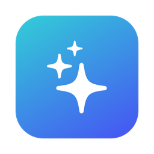

<div align="center">



# MacSweep

**軽量・安全・オープンソースの macOS クリーナー**

[English](README.md) · [简体中文](README.zh-CN.md) · **日本語**

純粋な SwiftUI · 約 2 MB · 依存なし · 通信なし · 削除したファイルはゴミ箱へ移動するので復元できます

</div>

---

## 🧰 3 つの機能

| | 機能 | 内容 |
| --- | --- | --- |
| ✨ | **スマートクリーン** | キャッシュ・ログ・開発ツールの不要ファイルなど 8 種類をスキャンし、選んだカテゴリをクリーン |
| 🔍 | **大きなファイル** | ホームフォルダ内の 100 MB / 500 MB / 1 GB / 5 GB 以上のファイルを検索。パスで絞り込み可能 |
| 🗑️ | **アンインストーラ** | アプリ本体と、`~/Library` 内のキャッシュ・設定・コンテナなどの残りファイルをまとめて削除 |

## ✨ 特長

- **3 言語対応**：中文 / 日本語 / English。システムの言語に合わせるか、「設定」ですぐに切り替え可能（CLI も対応）
- **モダンな UI**：サイドバー、ディスク使用量のリング、カラフルなカテゴリカード、サイズバー、ダークモード対応
- **背景のカスタマイズ**：「設定」から好きな画像をアップロード、またはウインドウにドロップ。暗さとぼかしを調整可能
- **スキャンしてからクリーン**：スキャンは読み取り専用。確認するまで何も削除しません
- **復元できる**：既定ではゴミ箱に移動。完全に削除されるのは「ゴミ箱を空にする」だけで、再確認があります
- **実行中のアプリを保護**：実行中のアプリのキャッシュには「実行中」と表示され、既定で選択されません
- **許可リスト方式**：決められたフォルダの中身だけを対象にし、フォルダ自体は削除せず、シンボリックリンクもたどりません
- **並列スキャン**：カテゴリとフォルダサイズを並列で計算し、通常 1 秒以内に完了
- **慎重な残りファイル判定**：bundle ID の境界を厳密に照合し、他のアプリを巻き込みません。Apple 製アプリはアンインストール不可
- **累計の記録**：これまでに解放した容量を記録
- **コマンドライン**：読み取り専用の `--scan`・`--large`・`--leftovers`、スクリプト用の `--json` 出力
- **小さなコード**：Swift ファイル 5 つを `swiftc` で直接ビルド。Xcode プロジェクト不要

## 🧹 クリーンアップの対象

| カテゴリ | 場所 | 既定 |
| --- | --- | :---: |
| ユーザキャッシュ | `~/Library/Caches` | ✅ |
| ログファイル | `~/Library/Logs` | ✅ |
| アプリ内キャッシュ | `~/Library/Application Support/*/{Cache,Code Cache,GPUCache,CachedData}` | ✅ |
| Xcode ビルドファイル | `DerivedData`・シミュレータキャッシュ・`iOS DeviceSupport` | ✅ |
| 開発ツールのキャッシュ | npm・yarn・pnpm・Gradle・CocoaPods・Cargo | ✅ |
| Conda パッケージ | `anaconda3/pkgs/*.conda`（`conda clean -p` と同等） | ⬜ |
| 古いインストーラ | `~/Downloads` 内の 30 日以上前の `.dmg / .pkg / .iso` | ⬜ |
| ゴミ箱 | `~/.Trash`（完全削除） | ⬜ |

選択状態は保存されます。カテゴリを追加するには、`Sources/Engine.swift` の `allRules` に規則を 1 つ追加するだけです。

## 📦 インストール

### 方法 1：ダウンロード

[Releases](https://github.com/DevX-star/MacSweep/releases) から `MacSweep-x.y.z.zip` をダウンロードし、展開して「アプリケーション」に移動します。Apple シリコンと Intel に対応、macOS 13 以降が必要です。

> Apple の公証を受けていないため、「開発元を検証できません」と表示された場合は、右クリック →「開く」を選ぶか、次を実行してください：
> ```bash
> xattr -dr com.apple.quarantine /Applications/MacSweep.app
> ```

### 方法 2：ソースからビルド

macOS 13 以降と Xcode コマンドラインツール（`xcode-select --install`）が必要です。

```bash
git clone https://github.com/DevX-star/MacSweep.git
cd MacSweep
./build.sh              # この Mac 向けにビルド → build/MacSweep.app
./build.sh universal    # Apple シリコン + Intel 向けにビルドし zip を作成
open build/MacSweep.app
```

## ⌨️ コマンドライン

```bash
MacSweep.app/Contents/MacOS/MacSweep --scan                # 削除できる内容をプレビュー
MacSweep.app/Contents/MacOS/MacSweep --large 1000          # 1 GB 以上のファイルを一覧
MacSweep.app/Contents/MacOS/MacSweep --leftovers Slack     # アプリと残りファイルを一覧
MacSweep.app/Contents/MacOS/MacSweep --scan --json         # JSON で出力
MacSweep.app/Contents/MacOS/MacSweep --help
```

コマンドラインは**読み取り専用**で、何も削除しません。クリーンはアプリから行ってください。

## 🗂️ コード構成

| ファイル | 内容 |
| --- | --- |
| `Sources/Engine.swift` | 規則・スキャン・大きなファイル検索・残りファイル判定・削除（UI に非依存） |
| `Sources/Models.swift` | 各画面の状態（ObservableObject） |
| `Sources/Views.swift` | SwiftUI のビューとコンポーネント |
| `Sources/Localization.swift` | 多言語：`t("中国語の原文")` で表を引いて翻訳。表を足せば言語を追加できます |
| `Sources/App.swift` | エントリポイントとコマンドラインモード |

## 🔒 権限について

- 管理者権限は不要。ユーザフォルダ（と `/opt/*conda*/pkgs`）だけを扱います
- 管理者がインストールしたアプリは、Finder で手動削除が必要な場合があります
- ゴミ箱をスキャンするには、**システム設定 → プライバシーとセキュリティ → フルディスクアクセス** に MacSweep を追加してください
- 通信もデータ収集も一切ありません。背景画像は `~/Library/Application Support/MacSweep/` に保存されます

## 🙏 謝辞

- [tw93/Mole](https://github.com/tw93/Mole) — カテゴリ別のディープクリーンの考え方
- [alienator88/Pearcleaner](https://github.com/alienator88/Pearcleaner) — 残りファイルも探すアンインストールと安全第一の設計
- [mac-cleanup/mac-cleanup-py](https://github.com/mac-cleanup/mac-cleanup-py) — 規則ベースのクリーンアップとドライラン

## 📄 ライセンス

[MIT](LICENSE)
